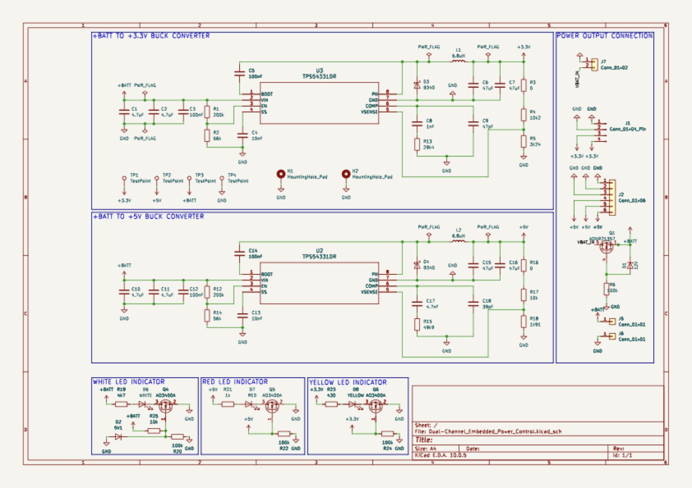
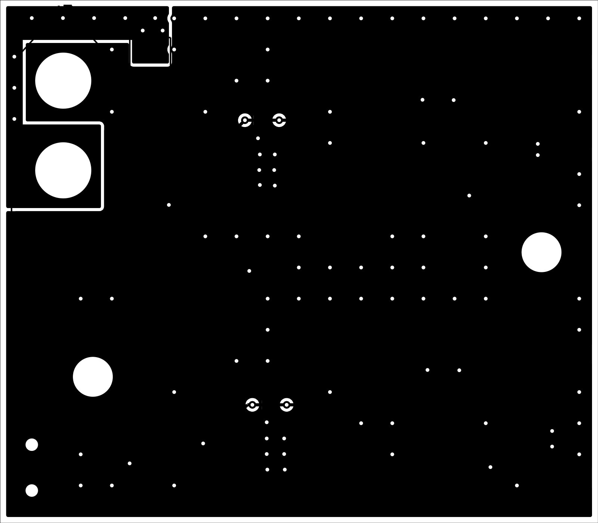
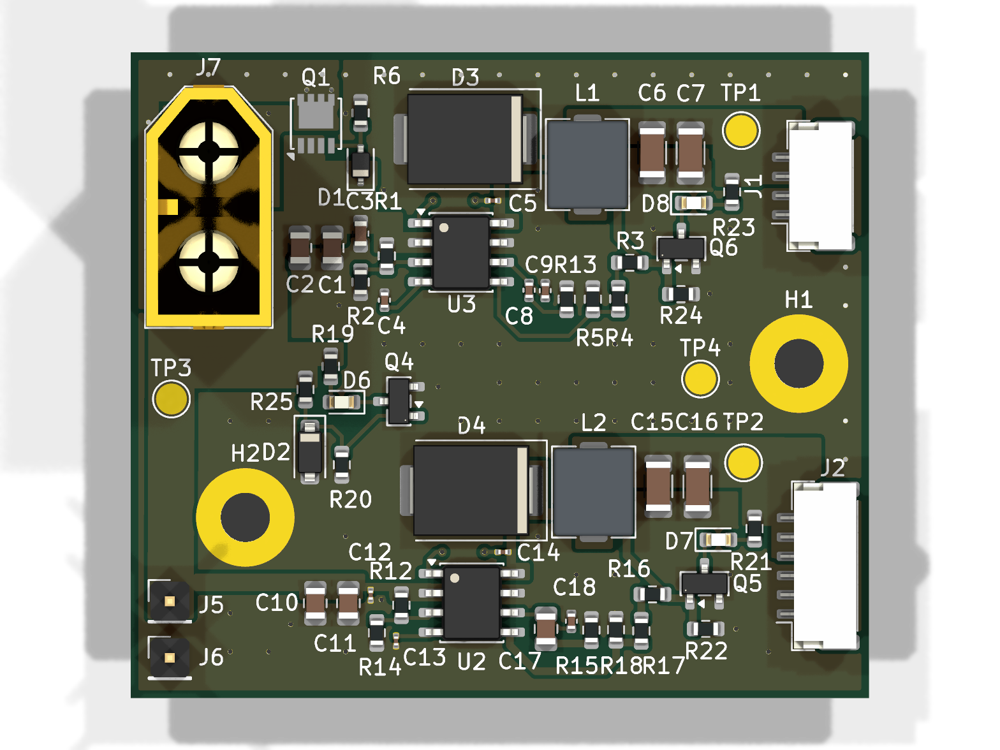

# Dual-Channel Embedded Power Control Board

[](LICENSE)
[](https://www.kicad.org/)

Battery-powered dual-output DC-DC power supply built around two Texas Instruments TPS54331 buck converters. Provides regulated +5 V and +3.3 V rails for embedded systems, with status LEDs, multiple output connectors, and accessible test points.

Designed as a compact two-layer PCB for portable and battery-powered electronics requiring efficient, low-noise power delivery.

## Table of Contents
- [Schematic](#schematic)
- [Layout](#layout)
- [3D Model](#3d-model)
- [Overview](#overview)
- [Specifications](#specifications)
- [Results](#results)
- [Tech Stack](#tech-stack)
- [Equipment](#equipment)
- [Manufacturing](#manufacturing)
- [Repository Structure](#repository-structure)
- [Contact](#contact)
- [License](#license)

## Schematic
[](Docs/Images/Dual-Channel_Embedded_Power_Control_Schematic.pdf)

## Layout


## 3D Model


## Overview

The board is a compact battery-powered dual-rail DC-DC power supply that generates regulated +5 V and +3.3 V outputs from a single +BATT input.

| Section                         | Description                                                                                                            |
| ------------------------------- | ---------------------------------------------------------------------------------------------------------------------- |
| **Reverse-Polarity Protection** | A high-side P-channel MOSFET (Q1, AONR21357) sits between the XT60 + pin and +BATT. Its gate is pulled to GND by R6 and clamped to 12 V by D1, so a reversed battery is blocked and the drop is about 15–45 mV. The J5/J6 headers connect after Q1, so power fed in through them is not protected. |
| **+BATT to +3.3 V Rail**        | A TPS54331 buck converter, 6.8 µH inductor, feedback network, compensation network, and soft-start circuit generate the regulated 3.3 V output. |
| **+BATT to +5 V Rail**          | A second TPS54331 buck converter uses independent feedback, compensation, and output filtering to generate the regulated 5 V output. |
| **Status Indication**           | Three LEDs provide visual power and rail-status indication.                                                            |
| **Connectivity**                | Multiple output headers and test points simplify integration with embedded systems and support bench measurements.      |

## Specifications

| Parameter                      | Value                                             |
| ------------------------------ | ------------------------------------------------- |
| **Input Voltage**              | 6–12 V (+BATT)                                    |
| **Output Rails**               | +5.0 V and +3.3 V                                 |
| **Buck Converters**            | 2 × Texas Instruments TPS54331DR                  |
| **Inductors**                  | 2 × 6.8 µH (FXL0530-6R8-M, 4 A sat)               |
| **Input UVLO**                 | Start ≈5.5 V / stop ≈4.9 V (EN divider 200 k / 56 k) |
| **Maximum Output Current**     | 1.5 A per rail (design target)                    |
| **Typical Efficiency**         | >90% at 1 A load                                  |
| **Output Ripple**              | <40 mVpp (measured)                               |
| **PCB Construction**           | Two-layer PCB                                     |
| **Protection and Monitoring**  | Reverse-battery protection on the XT60 input (P-FET), input UVLO, 4 ms soft-start, cycle-by-cycle current limit, status LEDs (no input TVS fitted) |

## Results

PCB measurements from the hand-soldered prototype:

| Rail       | Load  | Voltage | Ripple | Efficiency | Notes                     |
| ---------: | ----: | ------: | -----: | ---------: | ------------------------: |
| **3.3 V**  | 0.5 A | 3.31 V  | 28 mVpp | 91.4%     | Stable across input range |
| **3.3 V**  | 1.0 A | 3.29 V  | 35 mVpp | 90.2%     | Minimal voltage droop     |
| **5 V**    | 0.5 A | 5.02 V  | 31 mVpp | 92.1%     | Clean output              |
| **5 V**    | 1.0 A | 4.98 V  | 38 mVpp | 90.8%     | Excellent load regulation |

Both rails maintained regulation within ±1.5% across the 6–12 V input range.

## Tech Stack

| PCB Design | Version Control | Repository Hosting | Circuit Simulation | Editor |
| :--------: | :-------------: | :----------------: | :----------------: | :----: |
|  |  |  |  |  |

## Equipment

| Tool                   | Model                                          | Purpose |
| ---------------------- | ---------------------------------------------- | ------- |
| **Oscilloscope**       | Agilent Technologies InfiniiVision MSO-X 3034A | Output-ripple, load-step, and startup measurements |
| **Mixed-signal Tool**  | Digilent Analog Discovery 3                    | Frequency-response and transient analysis          |
| **Multimeter**         | Tektronix DMM4020A                             | DC voltage, current, and regulation measurements   |
| **Soldering Station**  | —                                              | Hand assembly of all SMD components                |

## Manufacturing

Production files are provided in the [`Manufacturing`](Manufacturing/) directory:

- [`BOM.csv`](Manufacturing/Assembly/BOM.csv) — JLCPCB-format bill of materials with LCSC part numbers (all parts in stock as of 2026-10-27)
- [`positions.csv`](Manufacturing/Assembly/positions.csv) — JLCPCB-format component placement (CPL) data
- [`Gerbers`](Manufacturing/Gerbers/) — Copper, mask, silkscreen, paste, outline, job, and drill files

Verify all fabrication outputs against the KiCad design before ordering.

## Repository Structure

```text
Dual-Channel_Embedded_Power_Supply_Board
├── .gitignore                                                                  Ignores OS files, KiCad user/backup files, and simulation outputs
├── Docs                                                                        Contains board-related documentation
│   └── Images                                                                  Contains the board render, layout, and schematic
│       ├── Dual-Channel_Embedded_Power_Control_3D-Model.png                    3D model in PNG format
│       ├── Dual-Channel_Embedded_Power_Control_Layout.png                      PCB layout in PNG format
│       ├── Dual-Channel_Embedded_Power_Control_Schematic.pdf                   Schematic in PDF format
│       └── Dual-Channel_Embedded_Power_Control_Schematic.png                   Schematic in PNG format
├── Hardware                                                                    Contains all KiCad PCB design files
│   ├── KiCad_Files                                                             Contains the 3D model, footprints, project files, and schematic symbol
│   │   ├── 3D_Models                                                           Contains STEP files used by the board model
│   │   │   └── TPS54331.stp                                                    STEP model for the TPS54331 buck converter
│   │   ├── Dual-Channel_Embedded_Power_Control.kicad_dru                       Custom DRC rules (0201 pad gap)
│   │   ├── Dual-Channel_Embedded_Power_Control.kicad_pcb                       KiCad PCB file
│   │   ├── Dual-Channel_Embedded_Power_Control.kicad_pro                       KiCad project file
│   │   ├── Dual-Channel_Embedded_Power_Control.kicad_sch                       KiCad schematic file
│   │   ├── Footprints                                                          Contains custom PCB footprints
│   │   │   └── TPS54331DR.pretty                                               Contains TPS54331DR footprints
│   │   │       ├── D8-L.kicad_mod
│   │   │       ├── D8-M.kicad_mod
│   │   │       └── D8.kicad_mod
│   │   ├── Symbols                                                             Contains custom schematic symbols
│   │   │   └── TPS54331DR.kicad_sym                                            TPS54331DR schematic symbol
│   │   └── sym-lib-table                                                       Project symbol library table
│   └── Simulation                                                              ngspice TPS54331 models, scripts, and results
│       ├── README.md                                                           Model description and results
│       ├── gen.py                                                              Generates the TPS54331 rail netlists (*.cir)
│       ├── v33_vin6.cir / v33_vin12.cir                                        3.3 V rail transient decks (6 V / 12 V in)
│       ├── v5_vin6.cir / v5_vin12.cir                                          5 V rail transient decks (6 V / 12 V in)
│       ├── analyze.py / plot.py                                                Post-processing and plots
│       ├── loop.py                                                             Small-signal loop gain / phase margin
│       ├── reverse_polarity.cir                                                Reverse-polarity P-FET simulation
│       ├── results.txt / loop_results.txt / reverse_polarity_results.txt       Simulation results
│       └── simulation_results.png                                              Result plots
├── LICENSE                                                                     CERN Open Hardware Licence Version 2 - Permissive for hardware
├── Manufacturing                                                               Contains bill of materials, pick-and-place, and Gerber files
│   ├── Assembly                                                                Contains bill of materials and pick-and-place data
│   │   ├── BOM.csv                                                             Bill of materials
│   │   └── positions.csv                                                       Pick-and-place data
│   └── Gerbers                                                                 Contains fabrication files
│       ├── Dual-Channel_Embedded_Power_Control-B_Cu.gbl
│       ├── Dual-Channel_Embedded_Power_Control-B_Mask.gbs
│       ├── Dual-Channel_Embedded_Power_Control-B_Paste.gbp
│       ├── Dual-Channel_Embedded_Power_Control-B_Silkscreen.gbo
│       ├── Dual-Channel_Embedded_Power_Control-Edge_Cuts.gm1
│       ├── Dual-Channel_Embedded_Power_Control-F_Cu.gtl
│       ├── Dual-Channel_Embedded_Power_Control-F_Mask.gts
│       ├── Dual-Channel_Embedded_Power_Control-F_Paste.gtp
│       ├── Dual-Channel_Embedded_Power_Control-F_Silkscreen.gto
│       ├── Dual-Channel_Embedded_Power_Control-job.gbrjob
│       ├── Dual-Channel_Embedded_Power_Control-NPTH.drl
│       ├── Dual-Channel_Embedded_Power_Control-NPTH-drl_map.gbr
│       ├── Dual-Channel_Embedded_Power_Control-PTH.drl
│       └── Dual-Channel_Embedded_Power_Control-PTH-drl_map.gbr
└── README.md                                                                   Project README
```

## Contact
- GitHub: [@devjamescollier](https://github.com/devjamescollier)
- Email: [jwcollie@usc.edu](mailto:jwcollie@usc.edu)

## License

Copyright © 2026 James Collier

The hardware design files are licensed under the CERN Open Hardware
Licence Version 2 – Permissive. See [LICENSE](LICENSE).
